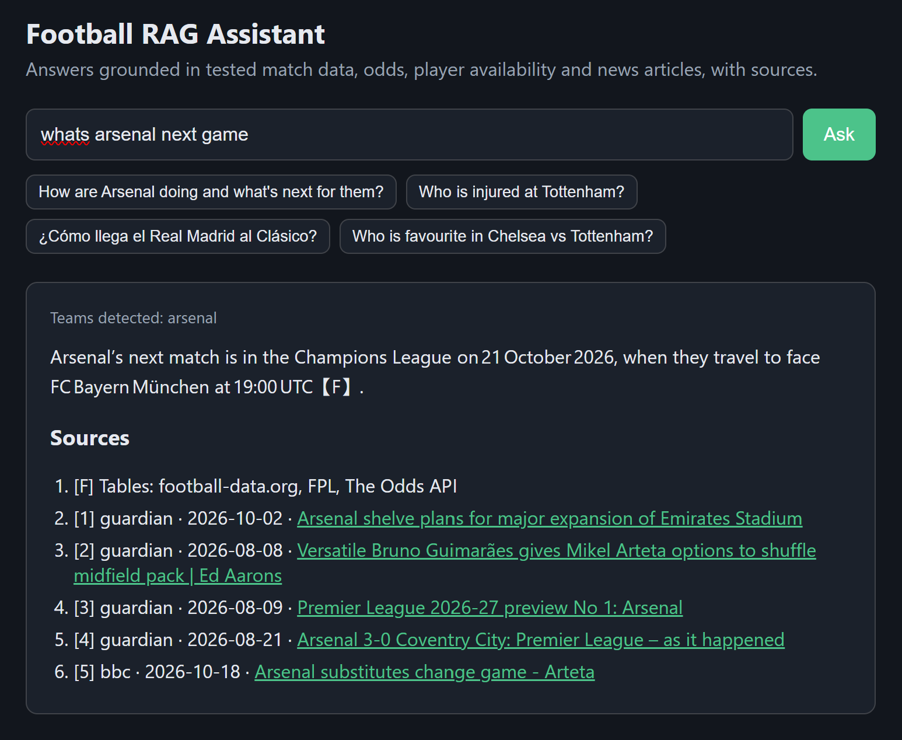
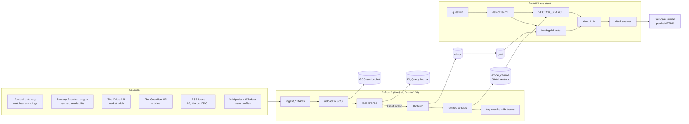

# ⚽ Football RAG — Matchday Assistant

**Ask a football question in English or Spanish, get a grounded answer with sources.**

👉 **Try it live:** https://football-rag.tail9198fe.ts.net/

> *"¿Cómo llega el Real Madrid a su próximo partido?"*
> → "El Real Madrid llega con tres victorias consecutivas (4‑1 ante el Sevilla, 4‑3 contra la Roma y 1‑0 al Villarreal)… ocupa la tercera posición con 21 puntos [F]. Su siguiente compromiso es el 21 de octubre ante el RB Leipzig en Champions [F]."



This is an end-to-end data + AI project built entirely on **free tiers**: daily ingestion from six public sources, a medallion lakehouse in BigQuery modeled with dbt, orchestration with Airflow, vector search over news articles, and an LLM that is only allowed to answer from the facts and passages it is given. It runs 24/7 on an Oracle Cloud Always Free VM. **Running cost: $0/month.**

---

## Table of contents
1. [What problem does it solve?](#1-what-problem-does-it-solve)
2. [Architecture](#2-architecture)
3. [Data sources](#3-data-sources)
4. [The pipeline, step by step](#4-the-pipeline-step-by-step)
5. [Data modeling (dbt)](#5-data-modeling-dbt)
6. [Retrieval: embeddings & vector search](#6-retrieval-embeddings--vector-search)
7. [Grounding: how hallucinations are prevented](#7-grounding-how-hallucinations-are-prevented)
8. [Evaluation](#8-evaluation)
9. [Serving the demo](#9-serving-the-demo)
10. [Tech stack](#10-tech-stack)
11. [Repository layout](#11-repository-layout)
12. [Run it yourself](#12-run-it-yourself)
13. [Design decisions & trade-offs](#13-design-decisions--trade-offs)
14. [Limitations & roadmap](#14-limitations--roadmap)

---

## 1. What problem does it solve?

A plain chatbot asked *"How is Arsenal doing?"* will confidently make up scores, because its knowledge stops at its training date. A plain search engine returns ten articles and leaves you to read them.

This assistant combines both worlds:

| Question type | Where the answer comes from |
|---|---|
| Hard numbers — results, table position, form, injuries, odds | **Structured tables** refreshed daily (cited as `[F]`) |
| Context — tactics, transfers, press conferences, opinion | **News passages** found by semantic search (cited as `[1]`, `[2]`…) |

The LLM writes the answer, but it only sees what the pipeline hands it, and it must cite it.

---

## 2. Architecture



---

## 3. Data sources

| Source | What it gives | Frequency | Load pattern |
|---|---|---|---|
| football-data.org | Matches, scores, standings for top competitions (PL, PD, CL…) | daily | lookback window, idempotent |
| Fantasy Premier League API | Player status, injury news, chance of playing | daily | **snapshot** (current-state source) |
| The Odds API | Bookmaker prices for upcoming fixtures | daily | snapshot, with a credit floor to protect the free quota |
| The Guardian Open Platform | Full-text football articles | daily | lookback window |
| RSS feeds (`config/rss_feeds.json`) | Spanish & English headlines/summaries | daily | append + dedupe |
| Wikipedia + Wikidata | Team founding year, profile text, aliases | weekly | candidates verified against Wikidata |

All raw responses are stored **as-is** (JSON) in GCS first, so any downstream bug can be fixed by re-processing — never by re-calling the API.

---

## 4. The pipeline, step by step

1. **Ingest** (`src/ingest_*.py`) — calls each API and writes timestamped JSON files locally.
2. **Upload** (`src/upload_to_gcs.py`) — copies them to the raw GCS bucket under `source/date/…`.
3. **Load bronze** (`src/load_bronze.py`) — loads each file into a BigQuery bronze table as raw JSON (*schema-on-read*). Loads are **idempotent**: rows for the same `object_path` are deleted before inserting, so re-running a day never duplicates data.
4. **Asset trigger** — each ingestion DAG publishes an Airflow **Asset**. The transform DAG is scheduled on those Assets, so it runs when new data actually lands, not on a guessed clock time.
5. **dbt build** — runs models *and* tests together: bronze → silver (clean, typed, deduped) → gold (business-ready tables).
6. **Embed** (`src/embed_articles.py`) — splits new articles into chunks, embeds them with `multilingual-e5-small`, and appends them to `article_chunks`.
7. **Tag** — links each chunk to the teams it mentions (via the `team_aliases` gold table), enabling filtered search.

Guards: `max_active_runs=1` prevents overlapping runs; unbuffered Python (`-u`) makes logs stream live; final tasks use `trigger_rule=all_done` where partial success is still useful.

---

## 5. Data modeling (dbt)

**Medallion layers**

| Layer | Purpose | Examples |
|---|---|---|
| bronze | Raw JSON, exactly as received | `bronze.matches_raw`, `bronze.fpl_raw` |
| silver | Typed, cleaned, deduplicated entities | `matches` (with status repair), `teams`, `articles`, `player_snapshots`, `player_availability`, `odds_quotes`, `odds` |
| gold | Tables the assistant reads directly | `team_match_results`, `standings`, `team_form`, `team_availability`, `upcoming_fixtures`, `team_profile`, `team_aliases`, `chunk_team_tags` |

**Highlights**
- **SCD Type 2 player availability** — FPL only tells you a player's status *today*. Daily snapshots are turned into history (valid_from / valid_to) using a *gaps-and-islands* approach with `is distinct from` comparisons, so you can ask "when did Saliba get injured?".
- **Match status repair** — matches stuck as `SCHEDULED` after kickoff are corrected from later data.
- **Odds → probabilities** — bookmaker prices are converted to implied probabilities and normalized to remove the bookmaker margin.
- **Seeds for human knowledge** — `team_code_overrides`, `team_wikipedia_overrides`, `odds_sport_keys`, `team_alias_overrides`, `team_alias_blocklist` (e.g. "Como" is a club *and* a Spanish word, so it is blocked as a bare alias).
- **Tests** — generic (`unique`, `not_null`, `accepted_values`, `relationships`) plus singular SQL tests (e.g. no negative scores, standings points = 3W + D). Noisy-but-non-fatal checks use `severity: warn`.
- Production runs use a dedicated **service account** target; nothing depends on a personal login.

---

## 6. Retrieval: embeddings & vector search

- **Model:** `intfloat/multilingual-e5-small` — 384-dimension vectors, runs on CPU, handles Spanish and English in the same space (a Spanish question can match an English article). It requires prefixes: `passage:` for documents, `query:` for questions.
- **Why 384 dims:** small enough to embed thousands of chunks per day on a free ARM CPU and keep BigQuery storage/scan costs near zero, while still good for news-length text.
- **Search:** BigQuery `VECTOR_SEARCH` with cosine distance — no separate vector database to host.
- **Entity pre-filter:** the question is scanned for team names/aliases (`detect_teams`). If teams are found, search is restricted to chunks tagged with those teams, which removes "semantically similar but wrong club" results.

---

## 7. Grounding: how hallucinations are prevented

The prompt sent to the LLM (`src/ask_assistant.py`) has two blocks:

```
--- FACTS ---
TEAM Arsenal FC: form last 5=WWWLW (12 pts), league=PL position=2 points=18, players out=3
RESULT Arsenal FC 2026-10-18 PL vs Nottingham Forest (away): 1-0, W
FIXTURE 2026-10-21 CL: FC Bayern München vs Arsenal FC, win probabilities 47% / 25% / 29%
ABSENCE Arsenal FC: Saliba (defender) injured - Back injury, chance of playing 0%
--- PASSAGES ---
[1] guardian 2026-10-16 | Mikel Arteta defends job cuts…
```

Rules that came from real bugs during development:
- **Every number comes from FACTS**, cited `[F]`. Opinions come from passages, cited `[n]`.
- **"No data" ≠ zero.** For leagues without injury data the fact says `absence data: not available (no data, NOT zero)`. Earlier, `players out=None` made the model claim "no injuries".
- **Spell things out.** "4-1 W" became "Real Madrid 4-1 Sevilla, result for Real Madrid: W" and odds are named per team — the model had confused home/away.
- **League games played** are included so the model doesn't divide points by the wrong number.
- If neither block answers the question, the model must say so (e.g. "the Ballon d'Or winner has not been decided yet").

---

## 8. Evaluation

Retrieval is measured, not eyeballed: `config/eval_questions.json` holds 30 questions with the teams/keywords a correct passage must contain. `src/eval_retrieval.py` reports:

| Metric | Meaning |
|---|---|
| hit@5 | Did at least one relevant passage appear in the top 5? |
| P@5 | Share of the top 5 that are relevant |
| entity P@5 | Share of the top 5 about the right team |
| MRR | How high the first relevant passage ranks |

Running it with and without `--entity-filter` showed the team pre-filter clearly improves entity precision — which is why it is on by default.

---

## 9. Serving the demo

- `src/api.py` — FastAPI app + `static/index.html` chat page. The embedding model loads once at startup (`/health` reports `model_loaded`).
- **Abuse protection** for a public free demo: 5 requests/minute per IP, 200 LLM calls/day globally, and a 1-hour LRU cache for repeated questions.
- **LLM:** Groq free tier, `openai/gpt-oss-120b`.
- **Hosting:** Oracle Cloud Always Free ARM VM (4 OCPU, 24 GB RAM). The app listens only on `127.0.0.1:8000`; **Tailscale Funnel** exposes it over HTTPS — no open firewall ports, no domain purchase.
- Airflow UI is reached through an SSH tunnel only.

---

## 10. Tech stack

| Area | Tools |
|---|---|
| Languages | Python, SQL |
| Orchestration | Apache Airflow 3 (CeleryExecutor, Assets) |
| Transformation | dbt (BigQuery adapter) |
| Storage / warehouse | Google Cloud Storage, BigQuery |
| Infrastructure as code | Terraform (bucket, datasets, service account, IAM, tables) |
| Containers | Docker, Docker Compose (custom ARM image with isolated `dbt-venv` and `ml-venv`) |
| AI / ML | sentence-transformers (multilingual-e5-small), BigQuery VECTOR_SEARCH, Groq LLM |
| App | FastAPI, Uvicorn, vanilla HTML/JS |
| Hosting | Oracle Cloud Always Free, Tailscale Funnel |

---

## 11. Repository layout

```
football-rag/
├── src/                  # ingestion, loading, embeddings, search, assistant, API
│   └── static/index.html # chat UI
├── dbt/                  # models (silver, gold), seeds, macros, tests
├── airflow/
│   ├── dags/             # football_ingestion.py, football_transform.py
│   ├── Dockerfile
│   ├── docker-compose.yaml       # Airflow stack
│   └── docker-compose.app.yaml   # public assistant
├── infra/                # Terraform (main.tf, vectors.tf)
├── config/               # rss_feeds.json, eval_questions.json
└── docs/                 # screenshots
```

---

## 12. Run it yourself

Prerequisites: a GCP project (free tier), Docker, Terraform, and free API keys for football-data.org, The Guardian, The Odds API and Groq.

```bash
# 1. Infrastructure
cd infra && terraform init && terraform apply

# 2. Secrets (never committed)
cp airflow/.env.example airflow/.env      # fill in API keys
# put the service-account JSON in airflow/secrets/

# 3. Airflow stack
cd airflow
docker compose up -d --build              # UI on :8080

# 4. Assistant
docker compose -f docker-compose.app.yaml up -d --build
curl http://localhost:8000/health

# 5. Ask from the CLI
docker compose exec -w /opt/airflow/project airflow-worker \
  /opt/airflow/ml-venv/bin/python -u src/ask_assistant.py "How are Arsenal doing?" --show-context
```

---

## 13. Design decisions & trade-offs

- **GCS before BigQuery** — raw files are the source of truth; reprocessing is free, API calls are rate-limited.
- **Schema-on-read bronze** — APIs change shape; storing raw JSON means a new field never breaks ingestion.
- **BigQuery for vectors** instead of a dedicated vector DB — one less service to host; the corpus is small enough.
- **Facts + passages** instead of pure RAG — numbers from tables are exact; text retrieval alone gave wrong scores.
- **Oracle VM over managed services** — Cloud Composer / Cloud Run would cost money; one free VM runs everything.
- **Data-aware scheduling** — transforms follow data arrival instead of fragile fixed times.

---

## 14. Limitations & roadmap

**Limitations**
- Injury data exists only for the Premier League (FPL); other leagues are explicitly marked "no data".
- Free API quotas limit competitions covered and odds refresh frequency.
- Team detection is alias-based; player-only questions ("How is Mbappé playing?") rely on text retrieval.

**Roadmap**
- Player entity detection and player-level stats.
- Hybrid search (keyword + vector) and a re-ranker.
- LLM-as-judge answer evaluation on top of the retrieval metrics.
- Uptime monitoring and alerting.

---

*Built by [Oscar Meléndez](https://oscar-melendez77.github.io/portfolio.html) as a portfolio project.*
